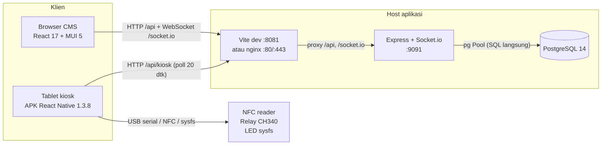
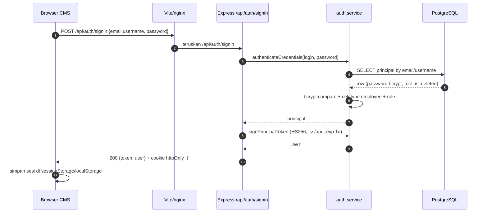
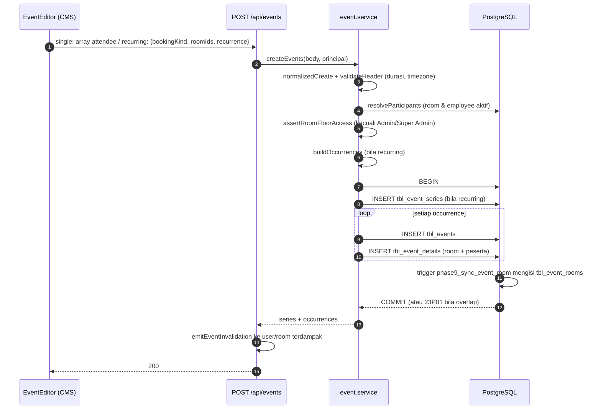
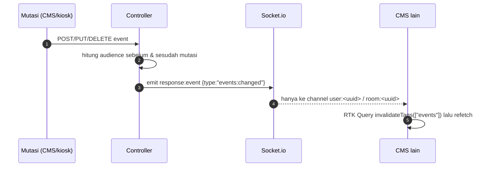

# Arsitektur RoomBooking

Dokumen ini menjelaskan komponen, alur request, dan batas kepercayaan aplikasi
**seperti kode saat ini** (diperiksa 2026-10-26). Versi acuan: CMS/API
`3.11.0` (Ver 3 Rev 12), APK kiosk `1.3.8` (code 19) — lihat
[`VERSIONING.md`](VERSIONING.md).

## 1. Komponen

| Komponen | Teknologi | Lokasi kode | Port (dev) |
|---|---|---|---|
| CMS (browser) | React 17, MUI 5, Redux Toolkit, React Router 5, FullCalendar | `client/` | disajikan Vite `:8081` |
| API + realtime | Express 4, Socket.io 4, `pg` Pool | `server/` | `:9091` |
| Basis data | PostgreSQL 14 (`btree_gist`) | `database/migrations/` | `:54320` (container demo) |
| Tablet kiosk | React Native + modul native (NFC, relay USB serial, LED sysfs) | repo `kioskapp` | klien keluar (outbound) |
| Reverse proxy (produksi) | nginx: statik CMS + proxy `/api/` dan `/socket.io/` | `deploy/nginx/360booking.conf` | `:80`/`:443` |
| Proses API (produksi) | systemd `360booking-server.service` | `deploy/systemd/` | `127.0.0.1:9091` |

Perangkat keras tidak punya service sendiri: tablet menulis LED lewat
`/sys/devices/platform/led_con_h/zigbee_reset`, membuka relay lewat USB serial
9600 8N1, dan membaca UID NFC lewat modul native `KioskHardwareModule`
(`kioskapp/android/app/src/main/java/com/kioskapp/hardware/KioskHardwareModule.java`).
Server tidak mengakses perangkat; untuk kiosk, server hanya menerima nomor
kartu yang sudah dinormalisasi tablet.

## 2. Diagram komponen



Catatan: APK kiosk **tidak** memakai Socket.io; tablet memuat ulang konteks dan
jadwal setiap 20 detik (`kioskapp/src/components/KioskDisplay.tsx`). Satu siklus
poll dicoba hingga **3 kali** dengan backoff (0,7 dtk lalu 1,4 dtk) sebelum
layar berubah ke `OFFLINE`, jadi restart singkat server tidak langsung
menampilkan offline. CMS memakai Socket.io untuk invalidasi
(`client/redux/websocket.js`).

## 3. Alur request

### 3.1 Login CMS



- Rate limit hanya menghitung percobaan gagal: 10 per akun per IP dan 100 per
  IP dalam 15 menit (`server/security/rate-limit.middleware.js`).
- Login room account ditolak karena `authenticateCredentials` mensyaratkan
  `type === "employee"` (`server/features/auth/auth.service.js:18-28`).
- Setelah login, setiap request membawa `Authorization: Bearer <token>`;
  middleware memverifikasi ulang akun ke DB, jadi akun yang dihapus/nonaktif
  langsung ditolak (`server/security/auth.middleware.js:9-18`).

### 3.2 Membuat meeting dari CMS



- Bentuk payload CMS saat ini: **single** dikirim sebagai array legacy
  (`client/domain/events/event-contract.js:104-119`), **recurring** memakai
  bentuk modern `roomIds`/`attendeeIds`/`visitorEmails`.
- Bentrok ruangan tidak dicek dengan `SELECT` lalu `INSERT`: constraint
  exclusion `tbl_event_rooms_no_overlap` yang menolak, dan kode `23P01`
  dipetakan menjadi `409 ROOM_CONFLICT`
  (`database/migrations/006_phase9_scheduler.sql:48-50`,
  `server/features/events/event.service.js:228`).
- `POST /api/events/preview` memakai perencanaan yang sama tetapi hanya
  mengembalikan daftar konflik (tanpa menulis DB).

### 3.3 Check-in dari kiosk

```mermaid
sequenceDiagram
  autonumber
  participant T as Tablet kiosk
  participant A as Express /api/kiosk
  participant K as kiosk.service
  participant D as PostgreSQL
  T->>A: PUT /api/kiosk/events/check-in {event_id, card_number}
  A->>A: requireKiosk (JWT audience kiosk + token_version)
  A->>K: checkInKioskEvent
  K->>D: BEGIN; SELECT event + booking ruangan FOR UPDATE
  K->>K: kartu harus milik organizer/peserta atau master card
  K->>K: now harus di [start - early_minutes, start + late_minutes)
  K->>D: UPDATE tbl_events SET checked_in = now()
  K->>D: COMMIT
  A->>A: emitEventInvalidation (user/room)
  A-->>T: 200 event
```

- Jendela check-in memakai dua nilai settings: `time_of_event_start_soon`
  (boleh check-in sebelum mulai) dan `not_checked_in_time_limit` (batas
  terlambat). Seed demo: 10 dan 15 menit
  (`database/seeds/development.sql:104-120`).
- Kiosk hanya boleh menyentuh event yang ruangannya sama dengan perangkat
  (`findKioskEventActionContext` memfilter `booking.room_id`).
- Bila kartu bukan milik organizer/peserta dan bukan master card → `403`;
  di luar jendela → `409 CHECK_IN_WINDOW`; sudah check-in →
  `409 ALREADY_CHECKED_IN` (`server/features/kiosk/kiosk.service.js`).
- Aksi **+15 menit** (`POST /api/kiosk/events/extend`) memakai verifikasi kartu
  yang sama: body wajib `card_number`, dan server menolak kartu yang bukan
  organizer/peserta/master (`403`). Guard ini tidak bisa dilewati dari UI.
- `GET /api/kiosk/context` mengirim `cmsVersion` dari `package.json` server;
  tablet menampilkannya di footer bersama versi APK
  (`v1.3.8 (19) · CMS 3.11.0`).

### 3.4 Invalidasi realtime



| Channel | Siapa yang join | Isi |
|---|---|---|
| `user:<uuid>` | Setiap karyawan saat connect | Invalidasi event yang ia organizer/peserta |
| `room:<uuid>` | Kiosk (otomatis), CMS saat memilih ruangan | Invalidasi jadwal ruangan |
| `device:<uuid>` | Kiosk (otomatis) | `response:kiosk-config` saat admin mengubah LED/NFC/judul; socket diputus saat perangkat dicabut |

- Handshake socket memakai JWT yang sama dengan HTTP; karyawan dan kiosk
  dibedakan dari klaim (`server/socket/webSocket.js`).
- Payload sengaja **tanpa data meeting**; klien wajib refetch lewat HTTP yang
  sudah menerapkan proyeksi privasi.
- Mutasi yang memindahkan meeting mengirim invalidasi ke audience lama **dan**
  baru (`mergeEventAudiences` di `server/socket/event-invalidation.js`).
- Timer server tiap 60 detik melepas booking no-show dan mengirim invalidasi
  (`server/server.js:49-58`).
- `response:setting` masih di-emit global, tetapi tidak ada listener di CMS
  (`client/redux/websocket.js` hanya mendengar `response:event`), sehingga
  perubahan settings belum otomatis menyegarkan halaman lain.

### 3.5 Kontrol akses, lantai, dan audit

Otorisasi berlapis, dari yang paling tetap ke yang paling mudah diubah:

| Lapis | Diatur oleh | Efek |
|---|---|---|
| Peran | `tbl_role` (`super_admin`, `admin`, `receptionist`, `user`) | Menentukan cakupan data (semua event, lantai, event sendiri) |
| Matrix menu | `tbl_role_menu_access` per peran × menu, disimpan Super Admin | `menuAccess(key)` menolak endpoint dengan `403`; navigasi CMS ikut menyembunyikan menu |
| Lantai | `tbl_users.floors` (fallback `tbl_users.floor`) | `coversFloor`/`coversAnyFloor` membatasi ruangan; `all` = semua lantai |
| Perlindungan akun | `tbl_users.is_protected` + role `super_admin` | Akun setup tidak bisa dihapus/diturunkan |

- `superAdminOnly` menjaga `/api/access/matrix` (GET/PUT) dan `/api/audit`.
  Super Admin melewati matrix dan selalu mendapat semua menu
  (`GET /api/access/menus` mengembalikan seluruh `MENU_KEYS`).
- `ADMIN` dan `SUPER_ADMIN` sama-sama dikecualikan dari aturan lantai
  (`FLOOR_EXEMPT_ROLES`) dan sama-sama boleh memesan atas nama karyawan;
  bedanya hanya matrix/audit dan hak menetapkan role Super Admin.
- Resepsionis memakai `floors` untuk dua hal: ruangan yang boleh dipesan
  (`assertRoomFloorAccess`) dan event yang boleh dilihat/diubah
  (`receptionistCoversEventFloor` memakai `event.room_floors`).
- `writeAudit` menulis `tbl_audit_log` di dalam transaksi yang sama dengan
  perubahan (role, lantai, kartu, reset sandi, settings, master card, matrix).
  Nomor kartu disamarkan; nama pelaku disalin agar riwayat tetap terbaca bila
  akunnya dihapus. Tidak ada endpoint ubah/hapus audit.
- Cache menu per peran berumur 30 detik di proses API; `saveMenuAccess`
  membersihkannya, jadi proses lain (bila kelak scale-out) bisa tertinggal
  maksimal 30 detik.

## 4. Zona waktu

| Aspek | Perilaku saat ini |
|---|---|
| Zona acuan | `APP_TIMEZONE`, default `Asia/Jakarta`; divalidasi saat boot dan gagal start bila bukan IANA valid (`config/config.js:78-82`) |
| Penyimpanan | `tbl_events.start_date/end_date` bertipe `timestamp without time zone` + kolom `timezone`; ditulis `$ts::timestamptz AT TIME ZONE $tz` dan dibaca `AT TIME ZONE e.timezone` |
| Input | Timestamp wajib menyertakan `Z` atau offset numerik (`parseInstant`, `server/features/events/event-time.js:61-70`) |
| Tanggal kalender | `GET /api/events` dan `/api/kiosk/schedule` memakai `YYYYMMDD` lokal, bukan ISO |
| Jam lokal tidak ada | Kombinasi tanggal+jam yang tidak ada di zona tersebut ditolak `400 INVALID_LOCAL_TIME` (`zonedPartsToDate`) |
| Rekurensi | Dihitung pada kalender lokal (hari/bulan), bukan dengan menambah 24 jam, sehingga pergantian DST tidak menggeser jam dinding |

`Asia/Jakarta` tidak memakai DST, tetapi kode tetap memakai konversi zona
generik agar aman bila `APP_TIMEZONE` diganti.

## 5. Privasi proyeksi

| Konteks | Aturan | Sumber |
|---|---|---|
| Kalender CMS, bukan organizer/peserta | `visibility:"busy"`, judul `[NamaDepan, HH:mm - HH:mm]`, tanpa subjek/deskripsi/peserta | `projectCalendarEvent`, `server/features/events/event.service.js:250-283` |
| Kiosk, judul | Selalu `[NamaDepan, HH:mm - HH:mm]`; subjek tidak pernah masuk judul | `getKioskSchedule`, `server/features/kiosk/kiosk.service.js:226-250` |
| Kiosk, `showSubject` | `false` → `subject` dan `organizerName` bernilai `null`; `true` → keduanya dikirim | kolom `tbl_kiosk_devices.show_subject` (default `true`, migrasi 011) |
| Socket.io | Hanya `{type:"events:changed"}`, tanpa subjek/peserta | `emitEventInvalidation` |
| HTTP detail event | Hanya Admin/Super Admin, organizer, peserta terdaftar, atau resepsionis yang memegang lantai ruangan | `getEventDetails`, `canView`, `server/features/events/event.service.js` |

Pemilik meeting tetap melihat data lengkap di CMS karena ia organizer; kartu
dan nomor kartu hanya dikembalikan ke admin (`publicEmployee`, migrasi
hardening 2026-10-23).

## 6. Dev vs produksi

| Aspek | Dev (`npm run demo`) | Produksi (nginx + systemd) |
|---|---|---|
| Origin | Dua proses: CMS `:8081`, API `:9091` | Satu origin `http(s)://<host>` |
| Proxy | Vite mem-proxy `/api/*` dan `/socket.io` ke `:9091` (`vite.config.js:65-80`) | nginx `location /api/` dan `/socket.io/` ke `127.0.0.1:9091` |
| Statik | Vite dev server | `/opt/360booking/client` + fallback SPA |
| Database | Container `360booking-postgres-test`, `127.0.0.1:54320` | PostgreSQL lokal `:5432` |
| CORS | `CORS_ORIGINS` diisi `.env.demo` + origin LAN dari `.env.local` | `CORS_ORIGINS=https://<domain>` (tanpa wildcard) |
| Trust proxy | kosong/false | `TRUST_PROXY=true` |
| Realtime | Vite mem-proxy WebSocket | nginx `Upgrade`/`Connection` + timeout 7 hari |

Catatan: di dev, `GET /api/health` tetap tanpa autentikasi sehingga dapat
dipakai sebagai probe.

## 7. Batasan yang diketahui

- Server berjalan **satu proses**: dependensi `redis` masih ada di
  `package.json`, tetapi tidak diimpor server mana pun; tidak ada adapter
  Socket.io Redis, jadi scale-out horizontal belum didukung.
- Content-Security-Policy dimatikan (`helmet({contentSecurityPolicy:false})`).
- APK kiosk memakai polling, bukan push; perubahan jadwal terlihat paling lama
  ~20 detik setelah invalidasi server.
- Perubahan settings belum menyegarkan klien lain secara realtime.
- `tbl_rooms` (tabel legacy) masih ada di skema tetapi tidak dipakai server;
  ruangan disimpan sebagai `tbl_users.type='room'`.

## 8. Belum dapat diverifikasi

- Perilaku nginx/TLS produksi belum dijalankan pada sesi ini; klaim pada
  bagian 6 berasal dari konfigurasi di `deploy/`, bukan hasil uji beban.
- Skala lebih dari satu instance API belum pernah diuji.
