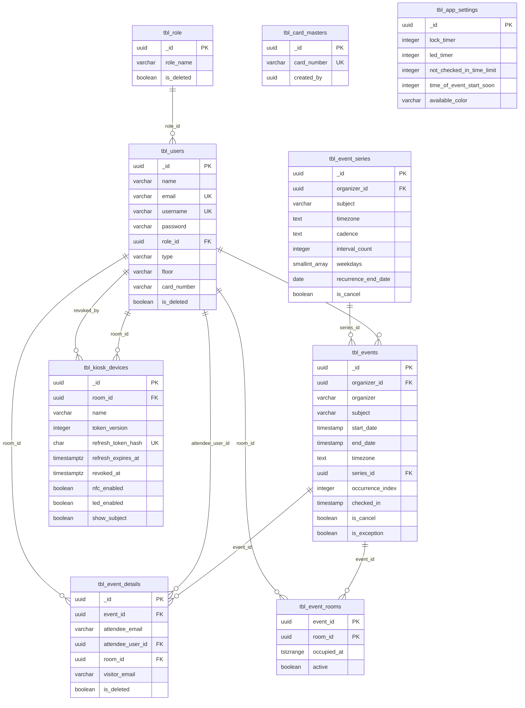

# ERD dan Kamus Data

Sumber: `database/migrations/001_prerequisites.sql` … `012_series_monthly_cadence.sql`.
Diperiksa 2026-10-24. Tidak ada ORM: server memakai SQL langsung, jadi nama
kolom di dokumen ini adalah nama fisik di PostgreSQL.

## 1. Diagram relasi



Catatan: `tbl_card_masters.created_by`/`updated_by` hanya referensi logis,
**tidak ada foreign key**. `tbl_users` menyimpan karyawan dan ruangan dalam
satu tabel; ruangan dibedakan `type='room'`.

## 2. Tabel utama

### 2.1 `tbl_users`

| Kolom | Tipe | Null/Default | Keterangan |
|---|---|---|---|
| `_id` | uuid | PK, `gen_random_uuid()` | ID akun |
| `name` | varchar | nullable | Nama tampilan |
| `email` | varchar | unique (case-insensitive) | Login CMS / email ruangan |
| `username` | varchar | nullable, unique parsial | Alternatif login |
| `password` | varchar | nullable | Hash bcrypt (cost 12 untuk akun baru) |
| `hashed_password` | varchar | nullable | Kolom legacy, tidak dipakai server |
| `role_id` | uuid | FK `tbl_role`, nullable | Dipakai karyawan; aplikasi mensyaratkan role; **harus NULL untuk ruangan** |
| `type` | varchar | `CHECK (employee, room)` | Pemisah akun |
| `floor` | varchar | nullable | Grup lantai; `all` = lintas lantai |
| `capacity` | varchar | nullable | Kapasitas ruangan (disimpan sebagai string) |
| `building`, `feature` | varchar | nullable | Metadata ruangan |
| `card_number` | varchar | nullable | Kartu karyawan (kredensial) |
| `is_deleted` | boolean | default false | Soft delete |
| `created_at`, `updated_at` | timestamp | default now | Audit |

Constraint/index penting (`005_phase9_identity.sql`, `009_room_role_separation.sql`):

- `tbl_users_email_lower_key` — unik pada `lower(email)`.
- `tbl_users_username_lower_key` — unik parsial pada `lower(username)` bila
  tidak NULL.
- `tbl_users_email_present` — email wajib, tidak kosong, mengandung `@`.
- `tbl_users_username_present` — username tidak boleh mengandung `@`.
- `tbl_users_type_check` — `type IN ('employee','room')`.
- `tbl_users_role_fk` — `role_id` → `tbl_role._id`.
- `tbl_users_room_role_check` — `type <> 'room' OR role_id IS NULL`.

### 2.2 `tbl_role`

| Kolom | Tipe | Keterangan |
|---|---|---|
| `_id` | uuid PK | ID peran |
| `role_name` | varchar | `admin` / `user` (dibandingkan case-insensitive) |
| `is_deleted` | boolean | Tidak dipakai untuk otorisasi saat ini |

Seed demo memakai UUID tetap: admin `471ba030-c950-41f9-90da-4e0fe10426a6`,
user `67e9500b-908a-497d-9d3b-54bc020700cb`.

### 2.3 `tbl_events`

| Kolom | Tipe | Null/Default | Keterangan |
|---|---|---|---|
| `_id` | uuid | PK | ID occurrence |
| `organizer` | varchar | nullable | Email organizer (legacy, disinkronkan trigger) |
| `organizer_id` | uuid | FK `tbl_users` | Pemilik meeting |
| `subject`, `description` | varchar | nullable | Judul/deskripsi |
| `start_date`, `end_date` | timestamp(6) without time zone | nullable | Jam dinding pada zona `timezone` |
| `timezone` | text | default `Asia/Jakarta` | Zona tafsir jam dinding |
| `series_id` | uuid | FK `tbl_event_series`, nullable | NULL untuk meeting tunggal |
| `occurrence_index` | integer | nullable | Urutan occurrence dalam seri |
| `original_start` | timestamp without time zone | nullable | Diisi trigger; dipakai jalur update |
| `is_exception` | boolean | default false | Occurrence yang diedit terpisah |
| `is_cancel`, `is_draft`, `is_allday` | boolean | default false | Status |
| `checked_in` | timestamp | nullable | Waktu check-in |
| `late_threshold` | integer | nullable | Legacy; aturan aktif memakai settings |
| `created_at`, `updated_at` | timestamp | default now | Audit |

Constraint (`006_phase9_scheduler.sql:7-39`):

- `tbl_events_time_order` — `CHECK (end_date > start_date)`.
- `tbl_events_organizer_fk` — `organizer_id` → `tbl_users._id`.
- `tbl_events_series_fk` — `series_id` → `tbl_event_series._id`.
- `tbl_events_occurrence_identity` — `series_id` dan `occurrence_index` harus
  sama-sama NULL atau sama-sama terisi (`occurrence_index >= 0`).
- `tbl_events_series_occurrence_key` — `UNIQUE (series_id, occurrence_index)`.

### 2.4 `tbl_event_details`

Satu baris = satu peserta (karyawan, ruangan, atau tamu).

| Kolom | Tipe | Null/Default | Keterangan |
|---|---|---|---|
| `_id` | uuid | PK | ID peserta |
| `event_id` | uuid | FK `tbl_events` ON DELETE CASCADE | Induk |
| `attendee_email` | varchar | nullable | Email asli |
| `attendee_user_id` | uuid | FK `tbl_users`, nullable | Karyawan |
| `room_id` | uuid | FK `tbl_users`, nullable | Ruangan |
| `visitor_email` | varchar | nullable | Tamu tanpa akun |
| `is_visitor` | boolean | default false | Penanda tamu |
| `is_deleted` | boolean | default false | Soft delete peserta |

Constraint penting (`005_phase9_identity.sql:77-85`):

- `tbl_event_details_identity_check` — `num_nonnulls(attendee_user_id,
  room_id, visitor_email) = 1`: tepat satu identitas.
- Index parsial `(event_id)`, `(attendee_user_id)`, `(room_id)` hanya untuk
  baris `is_deleted IS NOT TRUE`.

### 2.5 `tbl_event_rooms`

Tabel okupansi yang menjadi sumber aturan bentrok. Diisi otomatis oleh trigger,
bukan oleh service.

| Kolom | Tipe | Null/Default | Keterangan |
|---|---|---|---|
| `event_id` | uuid | PK, FK `tbl_events` ON DELETE CASCADE | Event |
| `room_id` | uuid | PK, FK `tbl_users` | Ruangan |
| `occupied_at` | tstzrange | NOT NULL, tidak kosong | Rentang `[start,end)` dalam UTC |
| `active` | boolean | default true | False bila batal/no-show |

Constraint kunci:

```sql
CONSTRAINT tbl_event_rooms_no_overlap
  EXCLUDE USING gist (room_id WITH =, occupied_at WITH &&)
  WHERE (active)
```

Artinya: untuk ruangan yang sama, dua baris **aktif** tidak boleh beririsan.
Ini yang mengubah bentrok menjadi `409 ROOM_CONFLICT` (kode PostgreSQL
`23P01`), termasuk saat dua request terjadi bersamaan.

### 2.6 `tbl_event_series`

| Kolom | Tipe | Null/Default | Keterangan |
|---|---|---|---|
| `_id` | uuid | PK | ID seri |
| `organizer_id` | uuid | FK `tbl_users`, NOT NULL | Pemilik |
| `subject`, `description` | varchar | NOT NULL | Header seri |
| `timezone` | text | NOT NULL | Zona setiap occurrence |
| `cadence` | text | `CHECK daily/weekly/monthly` | Setelah migrasi 012 |
| `interval_count` | integer | `CHECK 1..52` | Setiap berapa satuan |
| `weekdays` | smallint[] | nullable | 0=Sunday … 6=Saturday |
| `recurrence_end_date` | date | NOT NULL | Batas akhir |
| `is_cancel` | boolean | default false | Seri dibatalkan |
| `created_at`, `updated_at` | timestamptz | default now | Audit |

Catatan:
- **Pola bulanan tidak disimpan.** `monthlyPattern`, `monthWeekIndex`, dan
  `monthWeekday` hanya dipakai `recurrence.service` saat membuat occurrence;
  tabel seri tidak punya kolomnya. Jadi seri bulanan tidak dapat diregenerasi
  dari baris seri saja.
- `weekdays` tidak punya CHECK 0–6 di DB; validasi ada di aplikasi.
- Occurrence selalu **dimaterialisasi** sebagai baris `tbl_events`; tidak ada
  aturan RRULE yang dievaluasi saat baca.

### 2.7 `tbl_kiosk_devices`

| Kolom | Tipe | Null/Default | Keterangan |
|---|---|---|---|
| `_id` | uuid | PK | ID perangkat |
| `room_id` | uuid | FK `tbl_users`, NOT NULL | Ruangan pemilik tablet |
| `name` | varchar(80) | NOT NULL | Nama perangkat |
| `token_version` | integer | default 1, `CHECK > 0` | Dinaikkan saat refresh/revoke |
| `refresh_token_hash` | char(64) | NOT NULL, unique | SHA-256 refresh token |
| `previous_refresh_token_hash` | char(64) | nullable | Toleransi refresh ganda 30 detik |
| `previous_refresh_valid_until` | timestamptz | nullable | Batas toleransi |
| `refresh_expires_at` | timestamptz | NOT NULL | Masa berlaku refresh |
| `last_seen_at` | timestamptz | nullable | Online bila ≤60 detik |
| `revoked_at`, `revoked_by` | timestamptz/uuid | nullable | Pencabutan |
| `nfc_enabled` | boolean | default false | Fitur NFC per tablet |
| `led_enabled` | boolean | default true (migrasi 010) | LED per tablet |
| `show_subject` | boolean | default true (migrasi 011) | Tampilkan subjek di tablet |
| `created_at`, `updated_at` | timestamptz | default now | Audit |

Constraint: FK ruangan dan `revoked_by`, unique `refresh_token_hash`, index
parsial `room_id WHERE revoked_at IS NULL`.

**Tidak ada unique index “satu perangkat aktif per ruangan”.** Aturan itu
ditegakkan di service (`findActiveKioskDeviceForRoom`) sehingga dua request
pairing yang benar-benar bersamaan secara teori masih bisa lolos; belum ada
bukti uji balapan.

### 2.8 `tbl_card_masters`

| Kolom | Tipe | Keterangan |
|---|---|---|
| `_id` | uuid PK | ID kartu |
| `card_number` | varchar NOT NULL, UNIQUE | Nomor kartu master |
| `created_by`, `updated_by` | uuid | Referensi logis ke `tbl_users` (tanpa FK) |
| `created_at`, `updated_at` | timestamp | Audit |

Kartu master berlaku untuk check-in/selesai/buka pintu lintas peserta. Kartu
karyawan disimpan di `tbl_users.card_number`.

### 2.9 `tbl_app_settings`

Satu baris konfigurasi operasional; server selalu mengambil baris pertama
`ORDER BY created_at LIMIT 1`. Tidak ada constraint “hanya satu baris”.

| Kolom | Tipe | Dipakai untuk |
|---|---|---|
| `_id` | uuid PK | ID |
| `lock_timer`, `led_timer` | integer NOT NULL | Timer perangkat (tablet) |
| `table_input` | boolean NOT NULL | Mode input tablet |
| `not_checked_in_time_limit` | integer NOT NULL | Menit setelah mulai sebelum booking no-show dilepas |
| `time_of_event_start_soon` | integer NOT NULL | Menit sebelum mulai saat check-in dibuka |
| `available_color`, `will_start_color`, `on_meeting_color` | varchar NOT NULL | Kode warna/LED |

### 2.10 `tbl_rooms` (legacy)

Tabel `tbl_rooms` masih dibuat oleh `002_tables.sql` tetapi **tidak dipakai
server maupun CMS saat ini**. Ruangan hidup di `tbl_users` dengan
`type='room'`. Jangan menambah logika baru di tabel ini.

## 3. Trigger dan sinkronisasi

| Trigger | Waktu | Efek |
|---|---|---|
| `phase9_events_identity_trigger` | BEFORE INSERT/UPDATE `organizer`, `organizer_id`, `start_date` | Mengisi `organizer_id` dari email (atau sebaliknya) dan `original_start` |
| `phase9_detail_identity_trigger` | BEFORE INSERT/UPDATE identitas peserta | Menentukan `room_id` / `attendee_user_id` / `visitor_email` dari `attendee_email` |
| `phase9_detail_room_trigger` | AFTER INSERT/UPDATE/DELETE `tbl_event_details` | Menyusun ulang `tbl_event_rooms` untuk event terkait |
| `phase9_event_room_trigger` | AFTER UPDATE `start_date`, `end_date`, `is_cancel` | Menyusun ulang `tbl_event_rooms` |

Fungsi `phase9_sync_event_room` menghapus lalu menulis ulang seluruh baris
ruangan event; `active` = `is_cancel IS NOT TRUE AND is_deleted IS NOT TRUE`.
Karena itu pembatalan event atau pelepasan peserta ruangan otomatis
membebaskan slot, tanpa menghapus riwayat event.

## 4. Aturan yang tidak ada di skema

| Aturan | Ditegakkan di |
|---|---|
| Maksimal durasi booking (`MAX_BOOKING_DURATION_HOURS`, default 168 jam) | `event.service.validateHeader` |
| Rentang kalender maksimal 366 hari | `event.service.calendarRange` |
| Recurrence maksimal 366 hari / 200 occurrence | `recurrence.service` |
| Lantai karyawan = lantai ruangan | `assertRoomFloorAccess`, `resolveKioskEmployeeByCard` |
| Satu perangkat aktif per ruangan | `provisionKioskDevice` (aplikasi) |
| Check-in hanya dalam jendela settings | `event.service` / `kiosk.service` |
| Soft delete akun/ruangan | repository (`is_deleted`) |

## 5. Belum dapat diverifikasi

- Tidak ada uji migrasi dari database kosong pada sesi ini; pernyataan di atas
  berasal dari membaca SQL migrasi.
- Perilaku dua pairing bersamaan (race) belum diuji.
- Data produksi tidak diperiksa; jumlah baris dan kualitas `floor` di produksi
  tidak diketahui dari repo.
